<p align="center">
  <picture>
    <source media="(prefers-color-scheme: dark)" srcset="public/peel-logo-horizontal-dark-1600.png">
    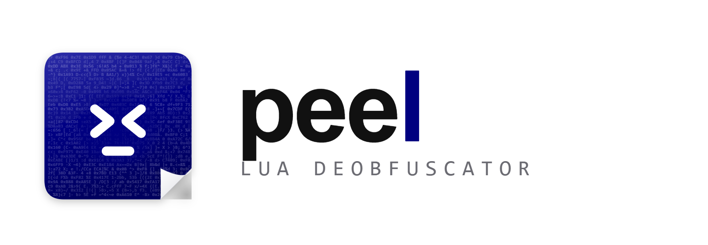
  </picture>
</p>

<p align="center">
  <b>Peel the obfuscation off Lua and Luau, right in your browser.</b><br>
  Open source · MIT · free forever · your code never leaves your device
</p>

<p align="center">
  <a href="README.tr.md">Türkçe</a> ·
  <a href="#quick-start">Quick start</a> ·
  <a href="#example">Example</a> ·
  <a href="#features">Features</a> ·
  <a href="#platforms">Platforms</a> ·
  <a href="#command-line">CLI</a> ·
  <a href="#how-it-works">How it works</a> ·
  <a href="#benchmark">Benchmark</a>
</p>

<p align="center">
  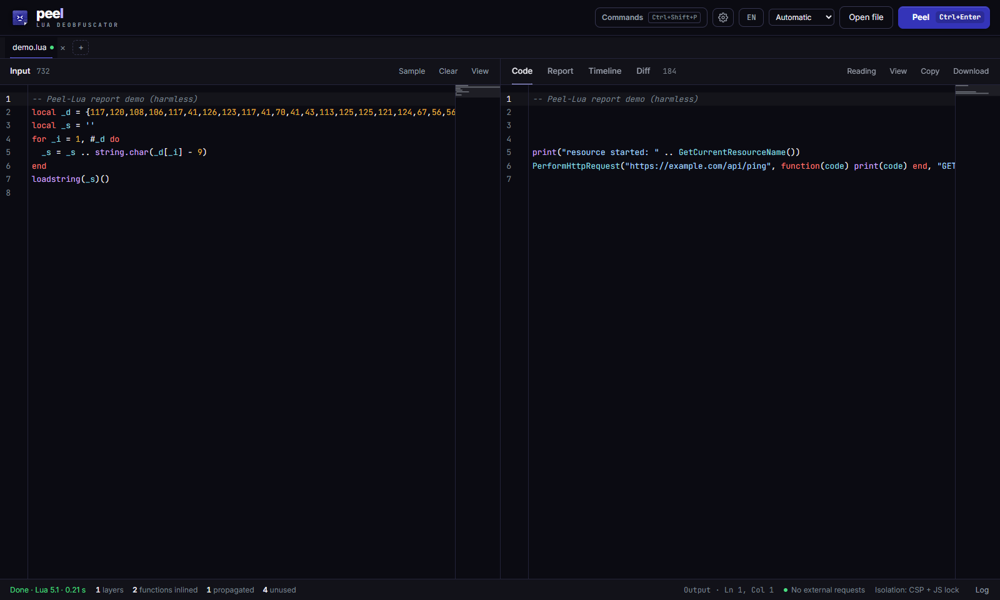
</p>

---

## What is PEEL?

PEEL is a Lua deobfuscator. Paste obfuscated Lua or Luau, press **Peel** (`Ctrl + Enter`), and you get readable code back,
plus a report of what the code actually does. It is built for the scripts people actually run into: Roblox exploits and
loaders, FiveM resources and Garry's Mod addons.

Most Lua obfuscators hide the real program behind `loadstring(...)` / `load(...)`, byte tables decoded with `string.char`,
encrypted string tables, metatable tricks or a whole virtual machine. Replacing `loadstring` with `print` by hand works for one
layer, then breaks on the next one. PEEL does it properly:

- **It runs the code, safely.** Real Lua 5.1, 5.2, 5.3 and 5.4 run as WebAssembly inside a separate worker or process with a
  watchdog. `load`, `loadstring`, `dofile` and `loadfile` are hooked: every layer is captured at runtime, together with the
  exact call site it came from, and written back there.
- **It proves its own changes.** After every pass the code is parsed again and run again. If stdout, the errors or the
  attempted side effects change, the pass is rolled back.
- **It never performs side effects.** `os.execute`, `io.popen`, file deletion and every network call are recorded, not
  executed. Roblox, FiveM and Garry's Mod APIs are replaced with stubs that record every call.
- **It tells you what the code does.** The report shows the obfuscator it detected, the HTTP requests, commands and file
  operations the code attempted, IOCs (URLs, Discord webhooks, Telegram bots, paste hosts) and a threat score with evidence,
  including FiveM and Garry's Mod backdoor patterns.
- **It stays on your machine.** There is no server, no telemetry and no upload. The status bar counts every external request
  the page makes, so you can check this yourself.

One button runs everything. There are no settings you have to understand first.

## Quick start

You need Node.js 25 or newer (the CLI sandbox uses Node's permission model).

```bash
git clone https://github.com/LLCForge/Peel-Lua.git
cd Peel-Lua
npm install
npm run dev
```

Open <http://localhost:5173>. Paste code, drop a `.lua` or `.luau` file onto the page, or click **Try the sample**, then press
**Peel**. The first run loads the four Lua runtimes from the same origin (under 1 MB of WebAssembly in total); later runs reuse
them.

To build a static site you can host anywhere:

```bash
npm run build
```

The `dist/` folder is the whole app, including the Lua runtimes and a `_headers` file with the sandbox CSP for Netlify and
Cloudflare Pages. It also works offline as a PWA after the first visit.

## Screenshots

<table>
  <tr>
    <td width="50%">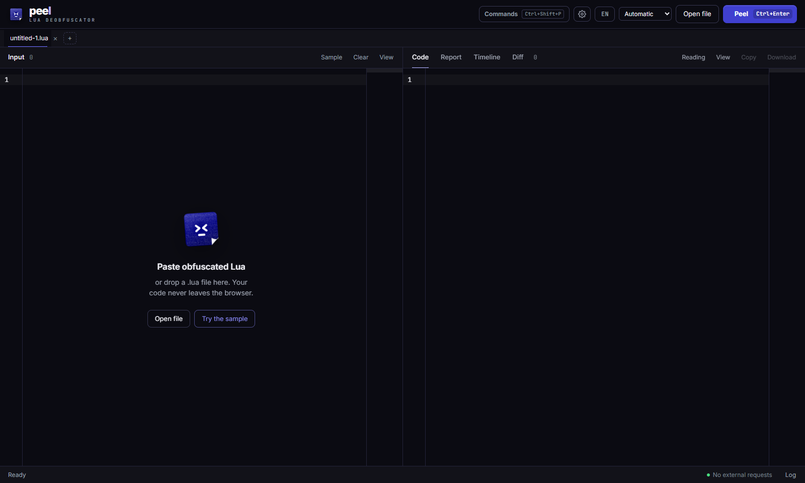<br><sub><b>Start screen.</b> Paste, drop a file or a folder, or try the sample.</sub></td>
    <td width="50%">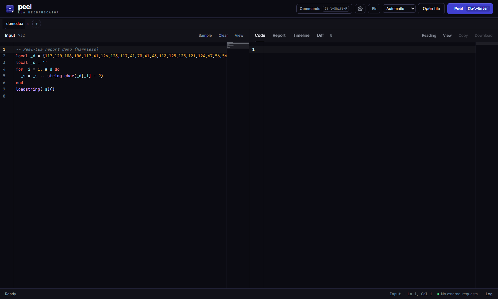<br><sub><b>Input.</b> A CodeMirror editor with Lua highlighting, folding and a minimap.</sub></td>
  </tr>
  <tr>
    <td>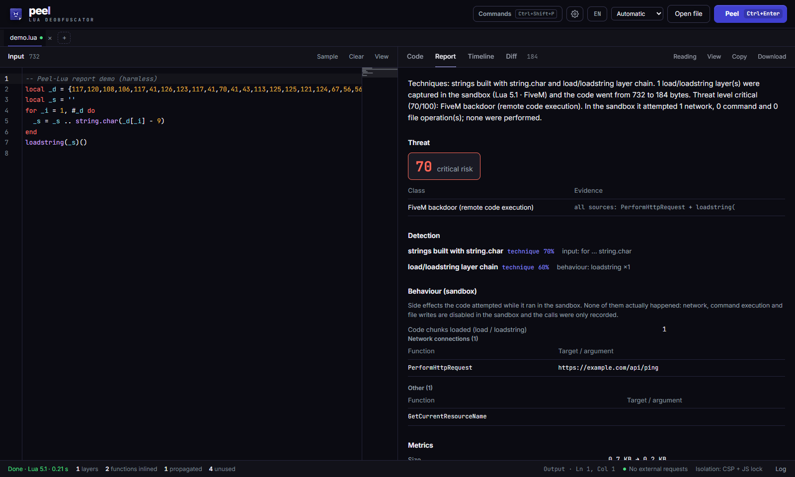<br><sub><b>Report.</b> Summary, threat score, detected techniques, the HTTP request the code attempted, metrics.</sub></td>
    <td>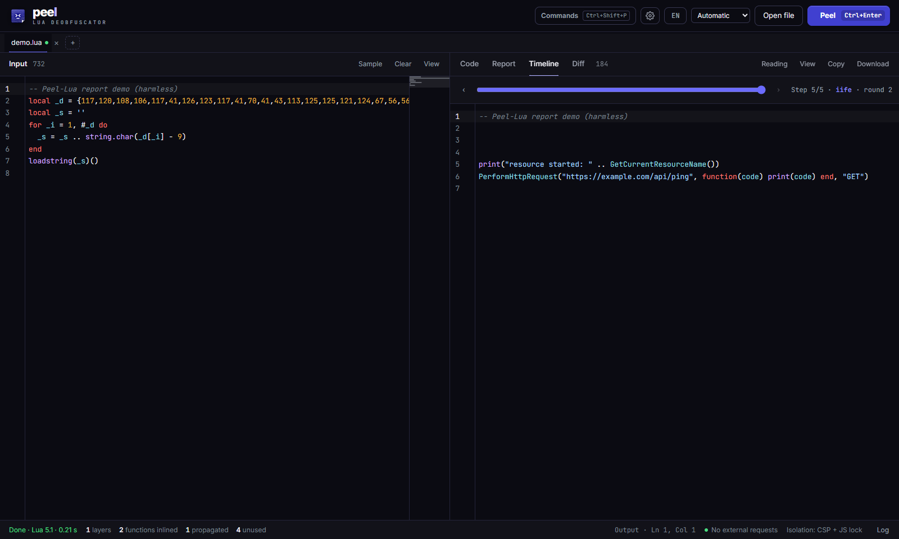<br><sub><b>Timeline.</b> Scrub through the code after every pass and round.</sub></td>
  </tr>
  <tr>
    <td>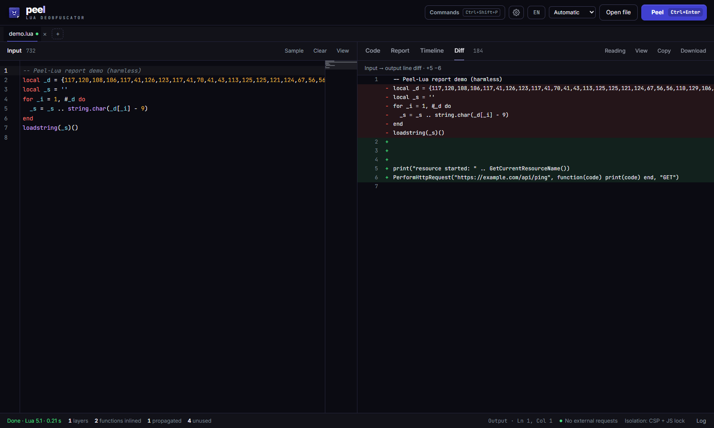<br><sub><b>Diff.</b> What changed between the input and the output.</sub></td>
    <td>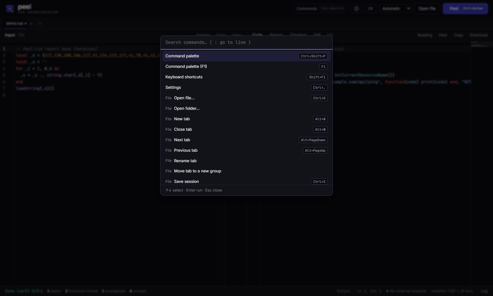<br><sub><b>Command palette.</b> Every action, searchable (<code>Ctrl + Shift + P</code>).</sub></td>
  </tr>
  <tr>
    <td colspan="2">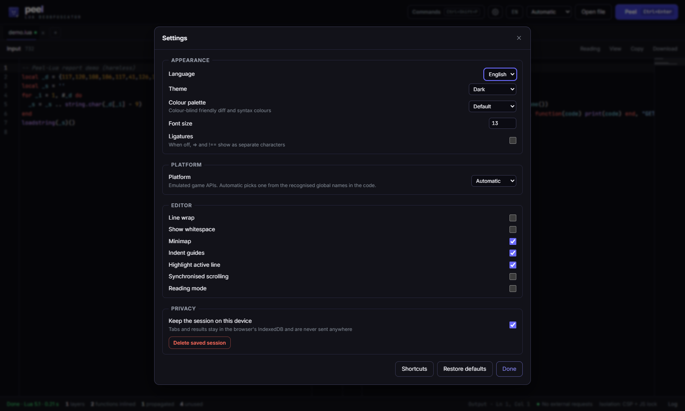<br><sub><b>Settings.</b> Language, theme, colour-blind palettes, platform, editor options and session storage.</sub></td>
  </tr>
</table>

<p align="center">
  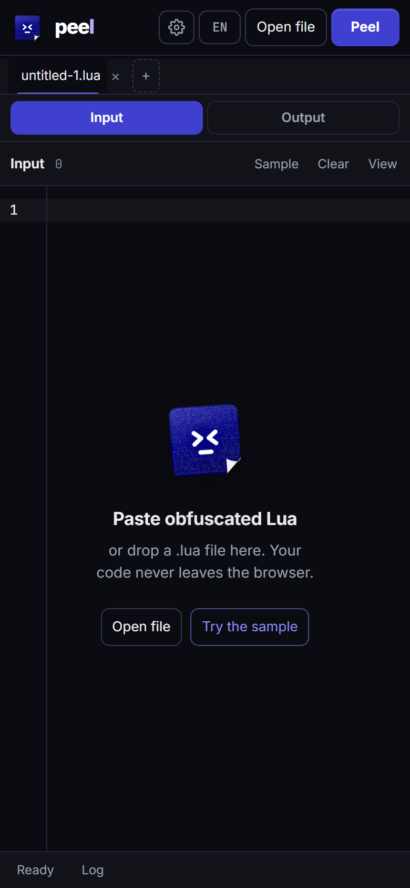<br>
  <sub>The interface also works on a phone.</sub>
</p>

The input in these screenshots is a harmless FiveM-style demo: a byte table decoded with `string.char` and run with
`loadstring`, whose payload prints a line and sends one `PerformHttpRequest` to `https://example.com`. Nothing was sent; the
request only shows up in the report. Because a hidden `loadstring` plus `PerformHttpRequest` is exactly what FiveM backdoors look
like, the report flags it, which is the point of the demo.

## Example

The built-in sample is a harmless loader: a byte table, a `string.char` decoder loop and `loadstring`. The payload contains a dead
branch.

```lua
-- Peel-Lua örnek girdisi
local _b = {115,118,106,104,115,39,114,104,121,108,115,108,121,39,68,39,130,132,17,109,118,121,39,112,39,68,39,56,51,…}
local _s = ''
for _i = 1, #_b do
  _s = _s .. string.char(_b[_i] - 7)
end
loadstring(_s)()
```

`node bin/peel-lua.js sample.lua --lang en` prints the decoded code to stdout and the summary to stderr:

```lua
-- Peel-Lua örnek girdisi

do
    local kareler = {}
    for i = 1, 4 do
        kareler[#kareler + 1] = i * i
    end

    print("Merhaba, Peel-Lua! " .. table.concat(kareler, ", "))
end
```

```text
[none 0/100] Techniques: strings built with string.char and load/loadstring layer chain. 1 load/loadstring layer(s) were
captured in the sandbox (Lua 5.1) and the code went from 703 to 189 bytes. No dangerous behaviour was found in the decoded
code (threat level none).
```

The decoder loop, the byte table and the `if 1 > 2 then ... end` branch are gone, the layer sits where `loadstring` was called,
and the result was behaviour-checked against the original. The `do ... end` block keeps the payload's locals in their own
scope, as they were inside the loaded chunk.

## Features

### Obfuscators

[Prometheus](https://github.com/levno-710/Prometheus) is in the [benchmark](#benchmark): its real output is peeled and checked
on every run.

| Prometheus step or preset | What PEEL does |
|---|---|
| `Minify`, `WrapInFunction`, `NumbersToExpressions`, `SplitStrings` | removed; constants folded back |
| `EncryptStrings`, `ConstantArray` | decoder calls and constant-array lookups replaced with the decoded strings, decoders removed |
| `ProxifyLocals` | metatable proxies (`x - "key"`, `E(x * v)`) turned back into plain locals |
| `Vmify` | devirtualised: the bytecode is lifted back into plain Lua functions (with `goto`, see [limits](#honest-limits)) |
| `Weak` preset (Vmify + ConstantArray + WrapInFunction) | fully recovered |
| `Medium` and `Strong` presets | behaviour preserved and names cleaned, but the VM and control-flow flattening stay (see [limits](#honest-limits)) |
| `Cff` (control-flow flattening) | strings and names recovered; the state machine itself is not removed |

The detector also recognises WeAreDevs (with its version), IronBrew / IronBrew2 (by its `gBits` readers and header),
Hercules and MoonSec V2 by their markers, plus generic techniques: `load` chains, Lua bytecode (`\27Lua`), `string.char`
strings, `\ddd` and `\xNN` escapes, `reverse` / `gsub` / XOR / base64 decoders, `lIlI1l` names, VM dispatchers and access through
`getfenv` / `_ENV`. Hercules and MoonSec V2 are identified by name only, and the report says so.

**Commercial protection is identified, not decoded.** Luraph, Moonsec V3, Luarmor and PSU (Perth's Synapse Utility) are
recognised only. The report reads what is stored in plain text: the banner and version, the Luarmor loader id, whether a
`script_key` is set (shown truncated) and the `LRM_*` variables used. Bypassing commercial licence protection is out of scope on
purpose.

### Passes

Ten passes run in this order, in rounds, until nothing changes (at most 20 rounds). Each one is a small module in
[`src/passes/`](src/passes).

| Pass | |
|---|---|
| `layers` | Writes the code captured from `load` / `loadstring` back at the exact call site. Sites whose code depends on outside input are left alone. |
| `vm` | Prometheus Vmify devirtualisation: the prototype graph is decoded in the sandbox (only the deserialiser runs, not user code), every instruction becomes the text of its handler, and the dispatcher disappears |
| `iife` | `(function() ... end)()` without arguments, `return` or `...` → `do ... end` |
| `proxify` | Prometheus ProxifyLocals metatable proxies → plain locals |
| `propagate` | Constants and aliases (`local ls = loadstring`, `local sc = string.char`) propagated to their uses |
| `fold` | Pure expressions computed by the real Lua in the sandbox: `string.char(104, 105)`, `("ab"):rep(2)`, `"a" .. "b"`, `table.concat({...})`, `bit32` / `bit` operations. Libraries that the file rebinds are not touched. |
| `strings` | String decoders and constant arrays (Prometheus EncryptStrings / ConstantArray and similar): each call site with constant arguments is captured in two runs with different clock, randomness and outside input, and becomes a literal only if both give the same value |
| `dead` | `if` / `elseif` / `while` branches with a literal condition (only `nil` and `false` are false in Lua) |
| `unused` | Liveness analysis: decoder loops, self-feeding variables, setup code and decoders that nothing reads any more |
| `rename` | Meaningless locals (`l_0_`, `IlIlIl`, `_0x1f`, scrambled one- or two-letter names) get names derived from their use: `i`, `k, v`, `fn`, `decode`, `str`, `num`, `tbl`, `floor`, `Players`, ... Globals are never renamed, and nothing is renamed when the `debug` library is used. |

### Engine

- **Verified passes.** After every pass the code is parsed again and run in the sandbox. stdout, errors and attempted side
  effects must match the original run; otherwise the pass is rolled back and the log says why.
- **Lua version selection.** The code runs on Lua 5.1, 5.4, 5.3 and 5.2 in that order, and the first version that runs it without
  errors is used. A pass whose output needs a newer version (devirtualised code uses `goto`, which needs 5.2) moves the pipeline
  to that version, after verifying there.
- **Luau.** Code that no Lua version can parse is lowered to Lua: type annotations, `type` / `export type`, generics and `::`
  casts are removed; compound assignments (`+=`, `..=`, ...), `continue`, string interpolation, `if` expressions, binary
  literals, `_` digit separators and Luau escapes are rewritten. In Node the original Luau code is also run in the
  [luau-web](https://www.npmjs.com/package/luau-web) runtime and compared with the lowered code.
- **Outside-input probe.** Before layers are unpacked, the code is run a second time where every outside value (HTTP
  responses, files, environment) is different. A layer that comes out different in the two runs depends on the outside world
  and is not unpacked, so a loader that runs whatever a server sends is not mistaken for a constant layer.
- **Deterministic runs.** Fixed clock, seeded randomness, and an instruction budget that stops infinite loops before the
  watchdog has to.
- **Formatting.** The result is formatted with [StyLua](https://github.com/JohnnyMorganz/StyLua); the formatted code is kept only
  if it still behaves the same.

### Analysis report

- Detected obfuscators and techniques, with confidence and evidence; for Prometheus also the likely preset
- Threat score and classes: FiveM backdoor, FiveM server config / key leak, txAdmin data / convar access, Garry's Mod
  backdoor, hidden admin grant, Roblox remote code loading (`loadstring` + `HttpGet`), Roblox `require(<asset id>)` backdoor,
  Roblox fake gift / purchase scam, player-data webhook logger, Discord / Telegram exfiltration, downloader, OS command
  execution, file deletion
- Behaviour from the sandbox: network calls with their targets, commands, file operations, other platform calls, number of
  loaded chunks
- IOCs: URLs, domains, IPs, emails, Discord webhooks, Telegram bot tokens and chat ids, paste / raw download hosts; platform and
  documentation domains (roblox.com, github.com, lua.org, ...) are listed separately as benign
- Commercial protection details (Luraph, Moonsec V3, Luarmor, PSU)
- Lua bytecode chunks that could not be turned into source, with their size and Lua version
- Metrics: size before and after, layers, rounds, rollbacks, Lua version, platform
- JSON export (and a plain-text version in the CLI)

### Interface

- CodeMirror editors with Lua highlighting, folding, minimap, search, bookmarks and line notes
- Multiple tabs and tab groups; open a file or a whole folder, or drop them onto the page; peel every file in a group
- Sessions saved on the device (IndexedDB), JSON session import and export
- Code, report, timeline and diff views; reading mode, focus mode, synchronised scrolling
- Command palette and configurable shortcuts
- Platform picker (automatic, Roblox, FiveM, Garry's Mod)
- Dark, light, high-contrast and system themes; deuteranopia, protanopia and tritanopia friendly colours
- Turkish and English
- Mobile layout, keyboard navigation, screen-reader labels and live regions, skip link
- Works offline as a PWA after the first visit (production build)

## Platforms

Game scripts call APIs that do not exist in plain Lua, so without help they would stop at the first `game:HttpGet` and nothing
behind it could be verified. PEEL loads stubs for the platform it recognises from global names in the code (or the one you pick
in the header or with `--platform`). Every stub call is recorded and shows up in the report; nothing is sent. When a layer that
was just unpacked reveals a platform API, the stubs are loaded and the behaviour baseline is taken again.

| Platform | Recognised by | Stubbed |
|---|---|---|
| **Roblox** | `game`, `workspace`, `Instance.new`, `getgenv`, `syn.request`, `HttpGet`, `HttpService` | `game`, `workspace`, `script`, `Instance`, `Vector3`, `CFrame`, `Color3`, `UDim2`, `Enum` (any path, any call), `HttpGet` / `HttpPost` / `GetAsync` / `PostAsync` returning a string, `syn`, `request` / `http_request`, `getgenv`, `setclipboard`, `writefile`, `readfile`, `isfile`, `wait`, `task`, `spawn` |
| **FiveM** | `Citizen`, `PerformHttpRequest`, `RegisterNetEvent`, `TriggerServerEvent`, `TriggerClientEvent`, `GetCurrentResourceName`, `RegisterServerEvent`, `AddEventHandler` | `Citizen`, `PerformHttpRequest` (the response callback is never called), `RegisterNetEvent`, `AddEventHandler`, `TriggerEvent` / `TriggerServerEvent` / `TriggerClientEvent`, `RegisterCommand`, `ExecuteCommand`, `GetCurrentResourceName`, `GetConvar`, `LoadResourceFile`, `SaveResourceFile`, `GetPlayers`, `GetPlayerName`, `CreateThread`, `Wait`, `SetTimeout` |
| **Garry's Mod** | `RunString`, `CompileString`, `http.Fetch`, `hook.Add`, `net.Receive`, `util.AddNetworkString`, `concommand.Add` | `http.Fetch`, `http.Post`, `HTTP`, `RunString` and `CompileString` (recorded as layers, so they are unpacked like `loadstring`), `hook`, `net`, `util`, `timer`, `concommand`, `player`, `game`, `file`, `SERVER`, `CLIENT` |

Roblox scripts are usually Luau; see [Luau](#engine) above.

## Command line

The CLI uses the same engine. In Node the sandbox runs in a child process started with `node --permission`.

```bash
node bin/peel-lua.js obfuscated.lua -o clean.lua --report report.json
cat obfuscated.lua | node bin/peel-lua.js - > clean.lua
node bin/peel-lua.js resources/ --out-dir out --report out/report.json
node bin/peel-lua.js server.lua --platform fivem -r text --lang en
node bin/peel-lua.js dropper.lua --json --fail-on high
```

Install it globally with `npm link` and use `peel-lua` instead of `node bin/peel-lua.js`.

| Option | |
|---|---|
| `-o, --out <file>` | write the decoded code to a file (single input; stdout otherwise) |
| `-d, --out-dir <dir>` | write decoded files to a directory (a directory input keeps its structure) |
| `-r, --report <target>` | `json` or `text` print the report to stdout instead of the code; any other value is a file path (`.txt` gives text, anything else JSON; an array for a directory input) |
| `--json` | same as `--report json` |
| `-p, --platform <name>` | platform stubs: `auto` (default, detected from the code), `roblox`, `fivem`, `gmod` |
| `--only <pass,...>` | run only these passes (`layers`, `vm`, `iife`, `proxify`, `propagate`, `fold`, `strings`, `dead`, `unused`, `rename`) |
| `--lang tr\|en` | report language (default `tr`) |
| `--fail-on <level>` | exit with code 4 when the threat level reaches `low`, `medium`, `high` or `critical` (for CI) |
| `-q, --quiet` | no progress or summary output |
| `-h, --help` | help |

A directory input is walked recursively for `.lua` and `.luau` files; symbolic links are not followed. Inputs are limited to
50 MB. Code is read and written as raw bytes, so binary strings survive unchanged.

Exit codes: `0` ok, `1` error, `2` usage error, `4` `--fail-on` threshold reached (takes precedence over errors).

## Library

```bash
npm install github:LLCForge/Peel-Lua
```

```js
import { readFile } from 'node:fs/promises';
import { peel, createSandbox } from 'peel-lua/src/index.js';

const sandbox = await createSandbox();
const { text, verified, version, platform, report } = await peel(await readFile('obfuscated.lua'), { sandbox, lang: 'en' });
console.log(text);              // readable code (UTF-8)
console.log(verified);          // true if every change was behaviour-checked
console.log(version, platform); // '5.1', 'fivem' | 'roblox' | 'gmod' | null
console.log(report.threat);     // { score, level, classes: [{ id, title, evidence }] }
console.log(report.iocs.urls);
sandbox.close();
```

| Export | |
|---|---|
| `peel(input, options)` | deobfuscate and analyse; `input` is a string or a `Uint8Array`. Returns the pipeline result plus `report` |
| `deobfuscate(input, options)` | the pipeline only: `{ code, text, verified, version, platform, luau, stats, events, trace, ms }`. `code` is a byte string (one character per byte), `text` the same code decoded as UTF-8 |
| `analyze({ input, output, ... })` | build a report from pipeline results |
| `createSandbox()` | a Node sandbox (child process) or a browser sandbox (Web Worker), depending on where it runs |
| `passes()` | the pass list in order |

Options: `platform` (`'roblox'`, `'fivem'`, `'gmod'`, `null` for none; detected when omitted), `only` (pass ids), `signal`
(`AbortSignal`), `onLog`, `onPass`, `onSnapshot`, `formatOutput` (default `true`), and `lang` for `peel`. Without a
`sandbox` option a shared one is created on first use.

The report format is documented at the top of [`src/core/analyze.js`](src/core/analyze.js).

## How it works

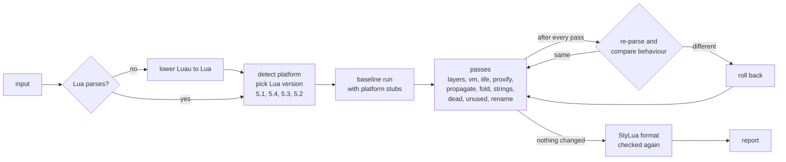

Parsing and rewriting happen in JavaScript with [luaparse](https://github.com/fstirlitz/luaparse), on the AST; user code runs
only in the sandbox ([`src/sandbox/`](src/sandbox)). Each run opens a fresh `lua_State` and loads the prelude
([`src/sandbox/prelude.js`](src/sandbox/prelude.js)) that hooks the loaders, records side effects and installs the platform
stubs. Code and results cross the boundary as hex, so binary strings and NUL bytes are never mangled.

| Folder | Contents |
|---|---|
| `src/passes/` | the 10 passes |
| `src/core/` | pipeline, pass order, Lua helpers, Luau lowering, scope analysis, report assembly |
| `src/sandbox/` | Lua and Luau engines, prelude, watchdog, Node and browser hosts |
| `src/report/` | detection, commercial protection, threat analysis, IOCs, summary |
| `src/ui/` | the web interface |
| `src/cli/`, `bin/` | the CLI |
| `test/` | fixtures, unit tests and the benchmark |
| `scripts/` | benchmark and fixture generators |

## Safety model

- **Code only runs in the sandbox.** Parsing, analysis and rewriting never execute user code; the sandbox is a separate
  process (Node) or Web Worker (browser).
- **Node (CLI, tests, library).** The sandbox process is started with `node --permission` and may read only `node_modules`, the
  sandbox files and `package.json`; child processes, workers and file writes are denied at the operating system level. This
  matters because the Node build of these Lua runtimes wires `os.execute` to a real `child_process`: the prelude replaces it with
  a recorder, and the permission model blocks it even if Lua code reaches the original. The test suite really tries this:
  `os.execute` and `io.popen`, and a search through `debug.getupvalue` and `debug.getregistry` for a real `execute` to call.
  A canary file must never appear.
- **Browser.** The sandbox worker gets its own Content Security Policy from its response header:
  `default-src 'none'; script-src 'self' 'wasm-unsafe-eval'; connect-src 'self'`. After the Lua runtimes load, the worker also
  removes `fetch`, `XMLHttpRequest`, `WebSocket`, `EventSource`, `WebTransport`, `importScripts`, nested workers, `caches`,
  `indexedDB`, `BroadcastChannel`, `eval`, the `Function` constructors and string timers. The status bar shows which layers are
  active. Hosts that cannot set headers (GitHub Pages) get only the JavaScript lock, and the status bar warns about it.
- **Watchdog.** Every request has a deadline (10 s for a run, 60 s for loading a runtime). A worker or process that hangs is
  killed and replaced. Inside Lua an instruction budget stops infinite loops first. **Stop** kills everything immediately.
- **No state leaks between runs.** Each run opens a new `lua_State` and closes it afterwards.
- **Fixtures are encoded on disk.** Test samples that look like malware are stored XOR + base64 encoded so antivirus software
  does not flag the repository, and are decoded only in memory.

## Honest limits

- Prometheus **Medium** and **Strong** presets are not devirtualised. Their output behaves the same and the names are cleaned
  up, but the VM and the control-flow flattening stay, and none of the original string literals come back (see the
  benchmark).
- Devirtualised **Vmify** output is correct but not pretty: it uses `goto` (Lua 5.2+) and stays at register level
  (`__r[1] = "Hello"`), close to the VM's instructions rather than the original source.
- A standalone **Cff** step gets its strings and names back, but the flattened state machine is not rebuilt into structured
  control flow.
- **IronBrew2** VMs are not targeted. IronBrew is detected, and its `loadstring` layers are unpacked like any others, but there
  is no devirtualiser for it.
- **Luraph**, **Moonsec V3**, **Luarmor** and **PSU** are identified only, never decoded.
- The **Luau runtime only runs in Node**. In the browser, Luau is still lowered to Lua, but the lowering cannot be checked
  against the original Luau code; the log says so. Some Luau constructs (type functions, `//`, `continue` inside a `repeat`
  body with locals) stop the lowering.
- Lua 5.4 code that uses attributes (`<const>`, `<close>`) is not parsed: the parser understands Lua up to 5.3 syntax.
- Lua bytecode (`\27Lua`) is listed in the report, not decompiled.
- The behaviour check compares stdout, errors and attempted side effects. Code that cannot run without its real environment
  gets only static transformations, and the result is marked as not verified.
- Values captured at runtime cover the paths that run took. Branches that did not run are not checked.
- Layers that depend on outside input (an HTTP response, a file, the environment) are kept, not unpacked.

## Tests

```bash
npm test                       # 25 fixtures through the whole pipeline with behaviour checks, then 7 unit test files
node test/run.js char-decoder  # a single fixture, with its log and output
```

A fixture is a `.lua.x` file in [`test/fixtures/`](test/fixtures) (encoded on disk, see above) with directive comments:

```lua
-- EXPECT: print('hi')   must appear in the output
-- GONE: loadstring      must not appear in the output
-- KEEP: HttpGet         must stay in the output (side effects and input-dependent code must not be deleted)
-- LUAU: verified        the Luau lowering must be verified in the luau-web runtime
```

The fixtures cover `load` chains (nested, aliased, Lua 5.4 `load`), `string.char` and decimal-escape decoders, constant arrays,
string decoders, IIFEs, dead branches, ProxifyLocals, a Prometheus VM, renaming, shebang lines, Luau syntax, and code that must
be kept: Roblox remote loaders, FiveM and Garry's Mod backdoors, side effects and input-dependent layers. The unit tests cover
the report and detectors (`analyze`), the CLI, translations, the Lua helpers, Luau lowering, the browser sandbox's load path and
CSP, and the sandbox escape attempts.

## Benchmark

```bash
npm run bench              # all samples
npm run bench vmify        # samples whose name contains the filter
npm run bench -- --show x  # input, log and output of one sample
```

[`test/bench/`](test/bench) holds 28 samples produced by running [Prometheus](https://github.com/levno-710/Prometheus) (commit
`a98c501`) with its presets and single steps over four harmless source programs
([`scripts/make-bench.js`](scripts/make-bench.js)). A sample passes when the peeled code prints exactly what the original
prints. When the obfuscated program itself prints something different from the original (a bug in the tool), the obfuscated
program's output is the bar. "All literals recovered" means every expected string of the original is back in the output.

Last run (`npm run bench`):

| Preset or step | Samples | Same behaviour | All literals recovered |
|---|---|---|---|
| Minify | 1 | 1 | 1 |
| Weak | 4 | 4 | 4 |
| Medium | 4 | 4 | 0 |
| Strong | 3 | 3 | 0 |
| Vmify | 4 | 4 | 4 |
| EncryptStrings | 3 | 3 | 3 |
| ConstantArray | 2 | 2 | 2 |
| ProxifyLocals | 2 | 2 | 2 |
| NumbersToExpressions | 2 | 2 | 2 |
| SplitStrings | 1 | 1 | 1 |
| WrapInFunction | 1 | 1 | 1 |
| Cff | 1 | 1 | 1 |
| **Total** | **28** | **28** | **21** |

The seven Medium and Strong samples keep a VM dispatcher and none of their original literals; their behaviour still matches.
One ProxifyLocals sample (`textutil`) is measured against the obfuscated program's own output, because Prometheus changes what
it prints. Single steps and the Weak preset take at most 2.2 seconds per sample, Medium about 3 to 7 seconds and Strong about 9
to 12 seconds.

## Contributing

Issues and pull requests are welcome. If you have a sample PEEL does not handle, please open an issue with a small, harmless
version of it. A pull request that adds a fixture proving the fix is the fastest way to get it merged.

## License

[MIT](LICENSE). Free to use, change and redistribute, including commercially. There is no paid tier, no account and no telemetry.
