<p align="center">
  <picture>
    <source media="(prefers-color-scheme: dark)" srcset="public/peel-logo-horizontal-dark-1600.png">
    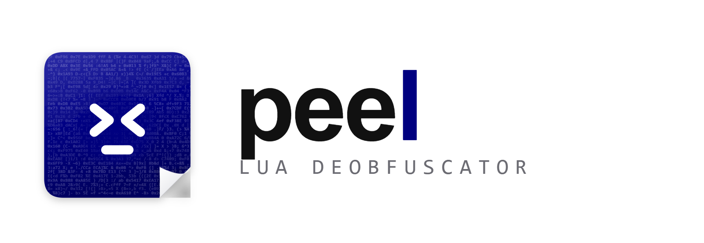
  </picture>
</p>

<p align="center">
  <b>Lua ve Luau'daki gizlemeyi tarayıcının içinde soyar.</b><br>
  Açık kaynak · MIT · sonsuza dek ücretsiz · kodunuz cihazınızdan çıkmaz
</p>

<p align="center">
  <a href="README.md">English</a> ·
  <a href="#hızlı-başlangıç">Hızlı başlangıç</a> ·
  <a href="#örnek">Örnek</a> ·
  <a href="#özellikler">Özellikler</a> ·
  <a href="#platformlar">Platformlar</a> ·
  <a href="#komut-satırı">CLI</a> ·
  <a href="#nasıl-çalışır">Nasıl çalışır</a> ·
  <a href="#benchmark">Benchmark</a>
</p>

<p align="center">
  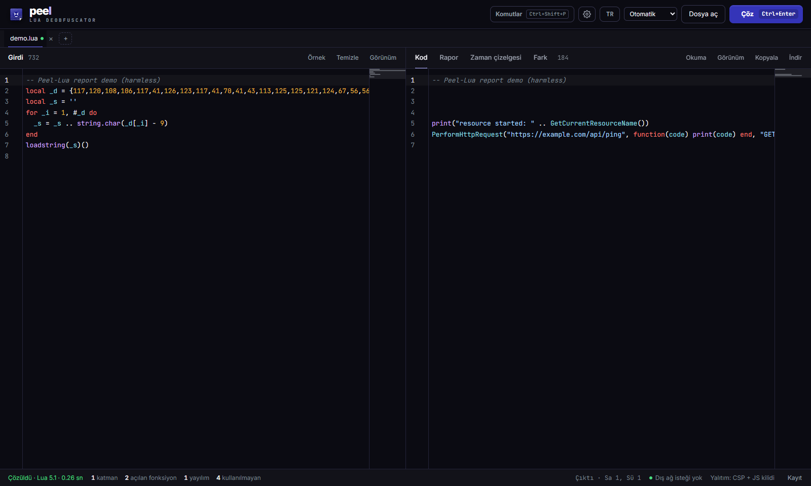
</p>

---

## PEEL nedir?

PEEL bir Lua deobfuscator'ıdır. Gizlenmiş (obfuscate edilmiş) Lua ya da Luau kodunu yapıştırın, **Çöz**'e basın
(`Ctrl + Enter`). Okunur kodu ve kodun gerçekte ne yaptığını anlatan bir raporu geri alırsınız. Gerçekte karşılaşılan betikler
için yapılmıştır: Roblox exploit'leri ve yükleyicileri, FiveM kaynakları ve Garry's Mod eklentileri.

Lua obfuscator'larının çoğu asıl programı `loadstring(...)` / `load(...)` çağrılarının, `string.char` ile çözülen bayt
tablolarının, şifreli dizge tablolarının, metatable hilelerinin ya da koca bir sanal makinenin arkasına saklar. `loadstring`'i
elle `print` ile değiştirmek bir katmanda işe yarar, sonrakinde bozulur. PEEL bunu düzgün yapar:

- **Kodu çalıştırır, güvenle.** Gerçek Lua 5.1, 5.2, 5.3 ve 5.4, bekçili ayrı bir worker ya da süreç içinde WebAssembly olarak
  çalışır. `load`, `loadstring`, `dofile` ve `loadfile` kancalanır: her katman, geldiği tam çağrı konumuyla birlikte çalışma
  anında yakalanır ve oraya geri yazılır.
- **Kendi değişikliklerini kanıtlar.** Her pass'ten sonra kod yeniden ayrıştırılır ve yeniden çalıştırılır. stdout, hatalar ya
  da denenen yan etkiler değişirse pass geri alınır.
- **Yan etkileri asla gerçekleştirmez.** `os.execute`, `io.popen`, dosya silme ve her ağ çağrısı kaydedilir, yapılmaz. Roblox,
  FiveM ve Garry's Mod API'leri her çağrıyı kaydeden taklitlerle karşılanır.
- **Kodun ne yaptığını söyler.** Raporda tespit edilen obfuscator, kodun denediği HTTP istekleri, komutlar ve dosya işlemleri,
  IOC'ler (URL'ler, Discord webhook'ları, Telegram botları, paste barındırıcıları) ve kanıtlarıyla bir tehdit puanı bulunur;
  FiveM ve Garry's Mod arka kapı kalıpları da buna dahildir.
- **Makinenizde kalır.** Sunucu, telemetri ya da yükleme yoktur. Durum çubuğu sayfanın yaptığı her dış isteği sayar; bunu
  kendiniz kontrol edebilirsiniz.

Tek düğme her şeyi çalıştırır. Önce anlamanız gereken bir ayar yoktur.

## Hızlı başlangıç

Node.js 25 ya da daha yenisi gerekir (CLI sandbox'ı Node'un izin modelini kullanır).

```bash
git clone https://github.com/LLCForge/Peel-Lua.git
cd Peel-Lua
npm install
npm run dev
```

<http://localhost:5173> adresini açın. Kodu yapıştırın, bir `.lua` ya da `.luau` dosyasını sayfaya sürükleyin veya **Örnek kodla
dene**'ye tıklayın, sonra **Çöz**'e basın. İlk çalıştırma dört Lua çalışma zamanını aynı kökenden yükler (toplam 1 MB'ın altında
WebAssembly); sonraki çalıştırmalar onları yeniden kullanır.

Her yerde barındırabileceğiniz statik bir site için:

```bash
npm run build
```

`dist/` klasörü uygulamanın tamamıdır; Lua çalışma zamanlarını ve Netlify ile Cloudflare Pages için sandbox CSP'sini içeren bir
`_headers` dosyasını da kapsar. İlk ziyaretten sonra PWA olarak çevrimdışı da çalışır.

## Ekran görüntüleri

<table>
  <tr>
    <td width="50%">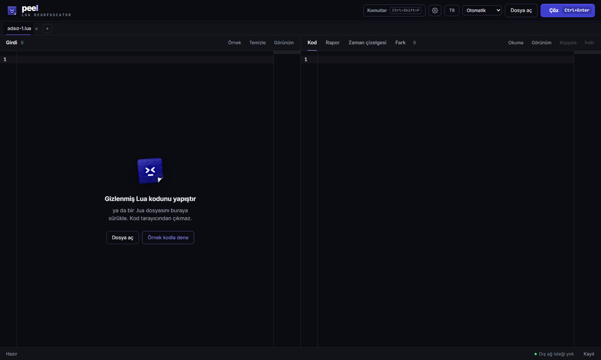<br><sub><b>Başlangıç.</b> Yapıştırın, dosya ya da klasör sürükleyin veya örneği deneyin.</sub></td>
    <td width="50%">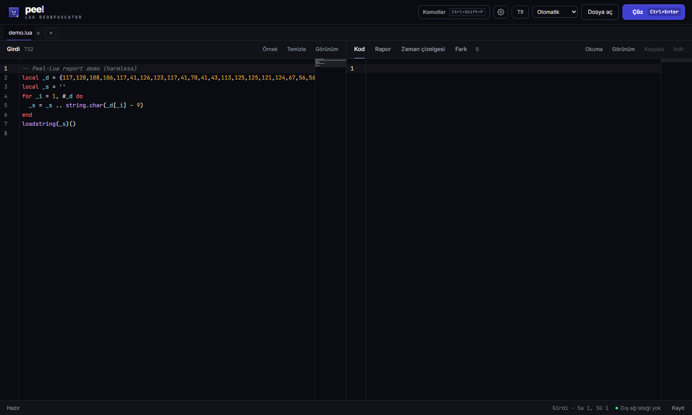<br><sub><b>Girdi.</b> Lua renklendirmesi, katlama ve mini haritalı CodeMirror editörü.</sub></td>
  </tr>
  <tr>
    <td>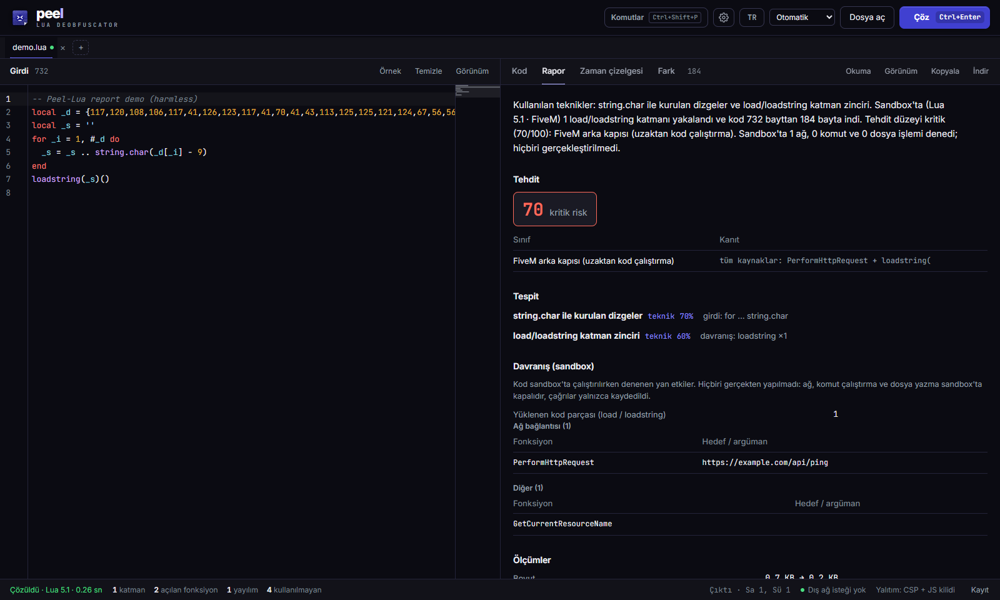<br><sub><b>Rapor.</b> Özet, tehdit puanı, tespit edilen teknikler, kodun denediği HTTP isteği, ölçümler.</sub></td>
    <td>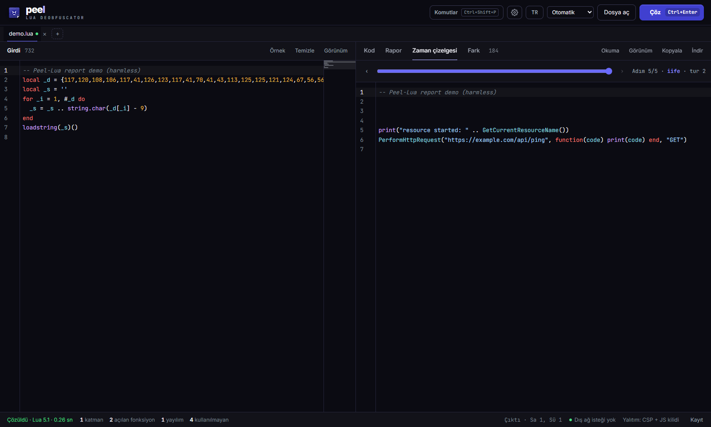<br><sub><b>Zaman çizelgesi.</b> Her pass ve tur sonrasındaki kodda ileri geri gidin.</sub></td>
  </tr>
  <tr>
    <td>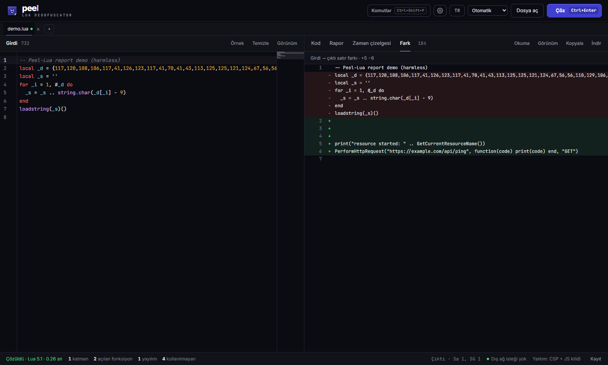<br><sub><b>Fark.</b> Girdi ile çıktı arasında neyin değiştiği.</sub></td>
    <td>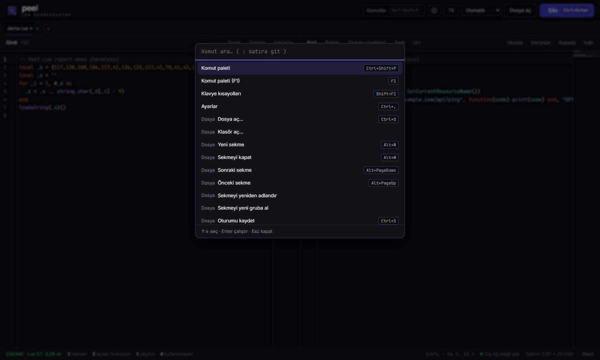<br><sub><b>Komut paleti.</b> Her işlem, aranabilir (<code>Ctrl + Shift + P</code>).</sub></td>
  </tr>
  <tr>
    <td colspan="2">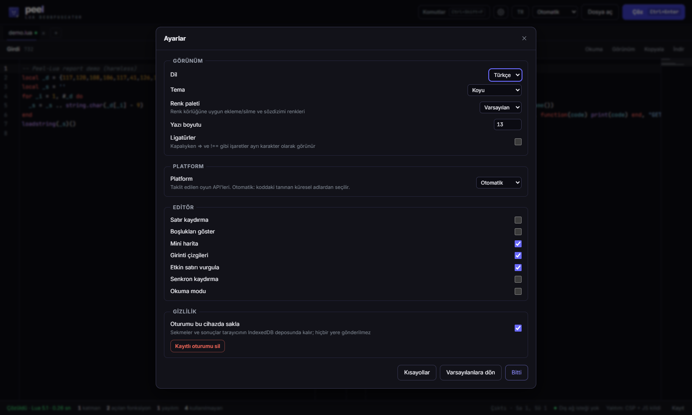<br><sub><b>Ayarlar.</b> Dil, tema, renk körlüğüne uygun paletler, platform, editör seçenekleri ve oturum kaydı.</sub></td>
  </tr>
</table>

<p align="center">
  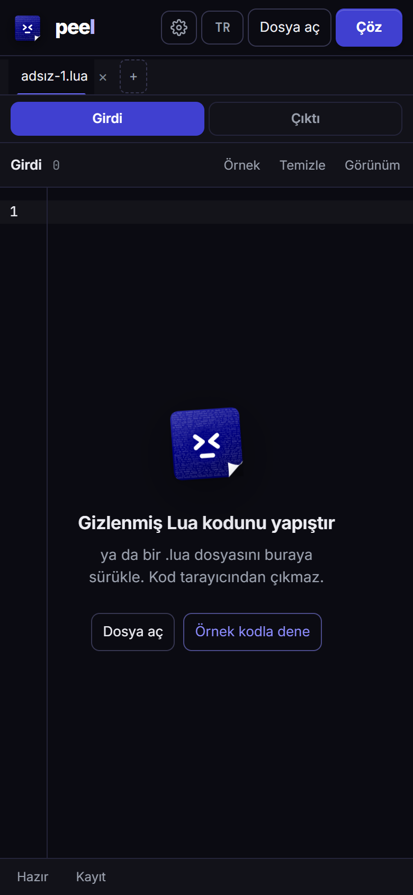<br>
  <sub>Arayüz telefonda da çalışır.</sub>
</p>

Bu görüntülerdeki girdi zararsız, FiveM tarzı bir örnektir: `string.char` ile çözülüp `loadstring` ile çalıştırılan bir bayt
tablosu; yükü bir satır yazdırır ve `https://example.com` adresine bir `PerformHttpRequest` gönderir. Hiçbir şey gönderilmedi;
istek yalnızca raporda görünür. Gizli bir `loadstring` ile `PerformHttpRequest` tam da FiveM arka kapılarının görünümü olduğu
için rapor bunu işaretler; örneğin amacı da budur.

## Örnek

Yerleşik örnek zararsız bir yükleyicidir: bir bayt tablosu, bir `string.char` çözücü döngüsü ve `loadstring`. Yükün içinde ölü
bir dal vardır.

```lua
-- Peel-Lua örnek girdisi
local _b = {115,118,106,104,115,39,114,104,121,108,115,108,121,39,68,39,130,132,17,109,118,121,39,112,39,68,39,56,51,…}
local _s = ''
for _i = 1, #_b do
  _s = _s .. string.char(_b[_i] - 7)
end
loadstring(_s)()
```

`node bin/peel-lua.js ornek.lua` çözülmüş kodu stdout'a, özeti stderr'e yazar:

```lua
-- Peel-Lua örnek girdisi

do
    local kareler = {}
    for i = 1, 4 do
        kareler[#kareler + 1] = i * i
    end

    print("Merhaba, Peel-Lua! " .. table.concat(kareler, ", "))
end
```

```text
[none 0/100] Kullanılan teknikler: string.char ile kurulan dizgeler ve load/loadstring katman zinciri. Sandbox'ta (Lua 5.1)
1 load/loadstring katmanı yakalandı ve kod 703 bayttan 189 bayta indi. Çözülmüş kodda tehlikeli bir davranış bulunmadı
(tehdit düzeyi yok).
```

Çözücü döngü, bayt tablosu ve `if 1 > 2 then ... end` dalı kalktı, katman `loadstring`'in çağrıldığı yere yazıldı ve sonuç özgün
kodla davranış olarak karşılaştırıldı. `do ... end` bloğu, yükün local'lerini yüklenen chunk'taki gibi kendi kapsamlarında tutar.

## Özellikler

### Obfuscator'lar

[Prometheus](https://github.com/levno-710/Prometheus) [benchmark](#benchmark)'ta yer alır: gerçek çıktısı her çalıştırmada
çözülür ve denetlenir.

| Prometheus adımı ya da preset'i | PEEL ne yapar |
|---|---|
| `Minify`, `WrapInFunction`, `NumbersToExpressions`, `SplitStrings` | kaldırılır; sabitler geri katlanır |
| `EncryptStrings`, `ConstantArray` | çözücü çağrıları ve sabit dizi erişimleri çözülmüş dizgelerle değişir, çözücüler silinir |
| `ProxifyLocals` | metatable vekilleri (`x - "anahtar"`, `E(x * v)`) düz local'lere döner |
| `Vmify` | sanallaştırma kaldırılır: bytecode düz Lua fonksiyonlarına geri çevrilir (`goto` ile, bkz. [sınırlar](#dürüst-sınırlar)) |
| `Weak` preset'i (Vmify + ConstantArray + WrapInFunction) | tamamen geri kazanılır |
| `Medium` ve `Strong` preset'leri | davranış korunur ve adlar temizlenir, ama VM ve kontrol akışı düzleştirmesi kalır (bkz. [sınırlar](#dürüst-sınırlar)) |
| `Cff` (kontrol akışı düzleştirme) | dizgeler ve adlar geri gelir; durum makinesinin kendisi kaldırılmaz |

Tespit modülü ayrıca WeAreDevs'i (sürümüyle), IronBrew / IronBrew2'yi (`gBits` okuyucuları ve başlığıyla), Hercules'i ve MoonSec
V2'yi işaretlerinden tanır; genel teknikleri de bulur: `load` zincirleri, Lua bytecode'u (`\27Lua`), `string.char` dizgeleri,
`\ddd` ve `\xNN` kaçışları, `reverse` / `gsub` / XOR / base64 çözücüleri, `lIlI1l` adları, VM dağıtıcıları ve `getfenv` / `_ENV`
üzerinden erişim. Hercules ve MoonSec V2 yalnızca ad işaretiyle tanınır; rapor bunu belirtir.

**Ticari koruma tanınır, çözülmez.** Luraph, Moonsec V3, Luarmor ve PSU (Perth's Synapse Utility) yalnızca tanınır. Rapor düz
metin olarak duranı okur: künye ve sürüm, Luarmor yükleyici kimliği, `script_key` tanımlı olup olmadığı (kısaltılarak gösterilir)
ve kullanılan `LRM_*` değişkenleri. Ticari lisans korumasını aşmak bilinçli olarak kapsam dışıdır.

### Pass'ler

On pass bu sırayla, turlar halinde, hiçbir şey değişmeyene kadar çalışır (en çok 20 tur). Her biri
[`src/passes/`](src/passes) altında küçük bir modüldür.

| Pass | |
|---|---|
| `layers` | `load` / `loadstring`'den yakalanan kodu tam çağrı konumuna geri yazar. Kodu dış girdiye bağlı siteler olduğu gibi kalır. |
| `vm` | Prometheus Vmify sanallaştırmasının kaldırılması: prototip grafiği sandbox'ta çözülür (yalnızca seri çözücü çalışır, kullanıcı kodu değil), her talimat kendi işleyicisinin metnine dönüşür ve dağıtıcı ortadan kalkar |
| `iife` | argümansız, `return` ve `...` içermeyen `(function() ... end)()` → `do ... end` |
| `proxify` | Prometheus ProxifyLocals metatable vekilleri → düz local'ler |
| `propagate` | Sabitler ve takma adlar (`local ls = loadstring`, `local sc = string.char`) kullanıldıkları yere yayılır |
| `fold` | Saf ifadeler sandbox'taki gerçek Lua ile hesaplanır: `string.char(104, 105)`, `("ab"):rep(2)`, `"a" .. "b"`, `table.concat({...})`, `bit32` / `bit` işlemleri. Dosyanın yeniden bağladığı kütüphanelere dokunulmaz. |
| `strings` | Dizge çözücüleri ve sabit dizileri (Prometheus EncryptStrings / ConstantArray ve benzerleri): sabit argümanlı her çağrı sitesi farklı saat, rastgelelik ve dış girdiyle iki çalıştırmada yakalanır; yalnızca ikisi aynı değeri verirse literal olur |
| `dead` | Koşulu literal olan `if` / `elseif` / `while` dalları (Lua'da yalnızca `nil` ve `false` yanlıştır) |
| `unused` | Canlılık analizi: çözücü döngüleri, kendini besleyen değişkenler, kurulum kodu ve artık kimsenin okumadığı çözücüler |
| `rename` | Anlamsız local'ler (`l_0_`, `IlIlIl`, `_0x1f`, karıştırılmış bir ya da iki harfli adlar) kullanımlarından türetilen adlar alır: `i`, `k, v`, `fn`, `decode`, `str`, `num`, `tbl`, `floor`, `Players`, ... Küresellerin adı asla değişmez; `debug` kütüphanesi kullanılıyorsa hiçbir ad değişmez. |

### Motor

- **Doğrulanmış pass'ler.** Her pass'ten sonra kod yeniden ayrıştırılır ve sandbox'ta çalıştırılır. stdout, hatalar ve denenen
  yan etkiler özgün çalıştırmayla aynı olmalıdır; değilse pass geri alınır ve log nedenini yazar.
- **Lua sürümü seçimi.** Kod sırasıyla Lua 5.1, 5.4, 5.3 ve 5.2'de çalıştırılır; onu hatasız çalıştıran ilk sürüm kullanılır.
  Çıktısı daha yeni bir sürüm gerektiren pass (sanallaştırması kaldırılmış kod `goto` kullanır, bu da 5.2 ister) hattı o sürümde
  doğruladıktan sonra o sürüme geçirir.
- **Luau.** Hiçbir Lua sürümünün ayrıştıramadığı kod Lua'ya indirilir: tip açıklamaları, `type` / `export type`, genel tipler ve
  `::` dönüşümleri silinir; bileşik atamalar (`+=`, `..=`, ...), `continue`, dizge enterpolasyonu, `if` ifadeleri, ikili
  literaller, `_` basamak ayırıcıları ve Luau kaçışları yeniden yazılır. Node'da özgün Luau kodu ayrıca
  [luau-web](https://www.npmjs.com/package/luau-web) çalışma zamanında çalıştırılıp indirilmiş kodla karşılaştırılır.
- **Dış girdi sondası.** Katmanlar açılmadan önce kod, dışarıdan gelen her değerin (HTTP yanıtları, dosyalar, ortam) farklı
  olduğu ikinci bir çalıştırmadan geçer. İki çalıştırmada farklı çıkan katman dış dünyaya bağlıdır ve açılmaz; böylece sunucunun
  gönderdiğini çalıştıran bir yükleyici sabit bir katman sanılmaz.
- **Belirlenimli çalıştırma.** Sabit saat, tohumlu rastgelelik ve sonsuz döngüleri bekçiye gerek kalmadan durduran bir komut
  bütçesi.
- **Biçimlendirme.** Sonuç [StyLua](https://github.com/JohnnyMorganz/StyLua) ile biçimlendirilir; biçimlenmiş kod ancak hâlâ aynı
  davranıyorsa tutulur.

### Analiz raporu

- Güven oranı ve kanıtıyla tespit edilen obfuscator'lar ve teknikler; Prometheus için olası preset de
- Tehdit puanı ve sınıfları: FiveM arka kapısı, FiveM sunucu yapılandırması / anahtar sızdırma, txAdmin verisi / convar okuma,
  Garry's Mod arka kapısı, gizli yönetici yetkisi verme, Roblox uzaktan kod yükleme (`loadstring` + `HttpGet`), Roblox
  `require(<varlık kimliği>)` arka kapısı, Roblox sahte hediye / satın alma kandırması, oyuncu bilgisi toplayan webhook logger,
  Discord / Telegram ile veri sızdırma, indirici, işletim sistemi komutu çalıştırma, dosya silme
- Sandbox'tan davranış: hedefleriyle ağ çağrıları, komutlar, dosya işlemleri, diğer platform çağrıları, yüklenen chunk sayısı
- IOC'ler: URL'ler, alan adları, IP'ler, e-postalar, Discord webhook'ları, Telegram bot token'ları ve sohbet kimlikleri, paste /
  ham dosya indirme adresleri; platform ve belge alanları (roblox.com, github.com, lua.org, ...) zararsız olarak ayrı listelenir
- Ticari koruma ayrıntıları (Luraph, Moonsec V3, Luarmor, PSU)
- Kaynağa çevrilemeyen Lua bytecode chunk'ları, boyutları ve Lua sürümleriyle
- Ölçümler: önce/sonra boyut, katmanlar, turlar, geri almalar, Lua sürümü, platform
- JSON dışa aktarma (CLI'da düz metin sürümü de)

### Arayüz

- Lua renklendirmesi, katlama, mini harita, arama, yer imleri ve satır notları olan CodeMirror editörleri
- Birden çok sekme ve sekme grupları; dosya ya da tüm klasörü açma veya sayfaya sürükleme; gruptaki her dosyayı çözme
- Cihazda kaydedilen oturumlar (IndexedDB), JSON oturum içe/dışa aktarma
- Kod, rapor, zaman çizelgesi ve fark görünümleri; okuma modu, odak modu, eşzamanlı kaydırma
- Komut paleti ve ayarlanabilir kısayollar
- Platform seçici (otomatik, Roblox, FiveM, Garry's Mod)
- Koyu, açık, yüksek karşıtlık ve sistem temaları; döteranopi, protanopi ve tritanopiye uygun renkler
- Türkçe ve İngilizce
- Mobil yerleşim, klavye ile gezinme, ekran okuyucu etiketleri ve canlı bölgeler, içeriğe geç bağlantısı
- İlk ziyaretten sonra PWA olarak çevrimdışı çalışma (üretim derlemesi)

## Platformlar

Oyun betikleri düz Lua'da olmayan API'leri çağırır; yardım olmadan ilk `game:HttpGet`'te dururlar ve arkasındaki hiçbir şey
doğrulanamaz. PEEL, koddaki küresel adlardan tanıdığı platformun (ya da üst çubukta veya `--platform` ile seçtiğiniz platformun)
taklitlerini yükler. Her taklit çağrısı kaydedilir ve raporda görünür; hiçbir şey gönderilmez. Yeni açılan bir katman bir platform
API'si ortaya çıkarırsa taklitler yüklenir ve davranış temeli yeniden alınır.

| Platform | Tanıyan adlar | Taklit edilenler |
|---|---|---|
| **Roblox** | `game`, `workspace`, `Instance.new`, `getgenv`, `syn.request`, `HttpGet`, `HttpService` | `game`, `workspace`, `script`, `Instance`, `Vector3`, `CFrame`, `Color3`, `UDim2`, `Enum` (her yol, her çağrı), dizge döndüren `HttpGet` / `HttpPost` / `GetAsync` / `PostAsync`, `syn`, `request` / `http_request`, `getgenv`, `setclipboard`, `writefile`, `readfile`, `isfile`, `wait`, `task`, `spawn` |
| **FiveM** | `Citizen`, `PerformHttpRequest`, `RegisterNetEvent`, `TriggerServerEvent`, `TriggerClientEvent`, `GetCurrentResourceName`, `RegisterServerEvent`, `AddEventHandler` | `Citizen`, `PerformHttpRequest` (yanıt geri çağrısı hiç çağrılmaz), `RegisterNetEvent`, `AddEventHandler`, `TriggerEvent` / `TriggerServerEvent` / `TriggerClientEvent`, `RegisterCommand`, `ExecuteCommand`, `GetCurrentResourceName`, `GetConvar`, `LoadResourceFile`, `SaveResourceFile`, `GetPlayers`, `GetPlayerName`, `CreateThread`, `Wait`, `SetTimeout` |
| **Garry's Mod** | `RunString`, `CompileString`, `http.Fetch`, `hook.Add`, `net.Receive`, `util.AddNetworkString`, `concommand.Add` | `http.Fetch`, `http.Post`, `HTTP`, `RunString` ve `CompileString` (katman olarak kaydedilir, yani `loadstring` gibi açılır), `hook`, `net`, `util`, `timer`, `concommand`, `player`, `game`, `file`, `SERVER`, `CLIENT` |

Roblox betikleri çoğunlukla Luau'dur; yukarıdaki [Luau](#motor) maddesine bakın.

## Komut satırı

CLI aynı motoru kullanır. Node'da sandbox, `node --permission` ile başlatılan bir alt süreçte çalışır.

```bash
node bin/peel-lua.js gizli.lua -o temiz.lua --report rapor.json
cat gizli.lua | node bin/peel-lua.js - > temiz.lua
node bin/peel-lua.js resources/ --out-dir cikti --report cikti/rapor.json
node bin/peel-lua.js server.lua --platform fivem -r text
node bin/peel-lua.js yukleyici.lua --json --fail-on high
```

`npm link` ile global kurup `node bin/peel-lua.js` yerine `peel-lua` yazabilirsiniz.

| Seçenek | |
|---|---|
| `-o, --out <dosya>` | çözülmüş kodu dosyaya yazma (tek girdi; yoksa stdout) |
| `-d, --out-dir <dizin>` | çözülmüş kodları dizine yazma (dizin girdisinde yapı korunur) |
| `-r, --report <hedef>` | `json` ya da `text` raporu kod yerine stdout'a yazar; başka bir değer dosya yoludur (`.txt` ise metin, değilse JSON; dizin girdisinde dizi) |
| `--json` | `--report json` ile aynı |
| `-p, --platform <ad>` | platform taklitleri: `auto` (varsayılan, koddan tanınır), `roblox`, `fivem`, `gmod` |
| `--only <pass,...>` | yalnızca bu pass'ler (`layers`, `vm`, `iife`, `proxify`, `propagate`, `fold`, `strings`, `dead`, `unused`, `rename`) |
| `--lang tr\|en` | rapor dili (varsayılan `tr`) |
| `--fail-on <düzey>` | tehdit düzeyi `low`, `medium`, `high` ya da `critical` eşiğine ulaşırsa 4 koduyla çıkma (CI için) |
| `-q, --quiet` | ilerleme ve özet yazmama |
| `-h, --help` | yardım |

Dizin girdisinde `.lua` ve `.luau` dosyaları özyinelemeli taranır; sembolik bağlar izlenmez. Girdi sınırı 50 MB'tır. Kod ham bayt
olarak okunur ve yazılır; ikili dizgeler bozulmadan kalır.

Çıkış kodları: `0` tamam, `1` hata, `2` kullanım hatası, `4` `--fail-on` eşiğine ulaşıldı (hatadan önceliklidir).

## Kütüphane

```bash
npm install github:LLCForge/Peel-Lua
```

```js
import { readFile } from 'node:fs/promises';
import { peel, createSandbox } from 'peel-lua/src/index.js';

const sandbox = await createSandbox();
const { text, verified, version, platform, report } = await peel(await readFile('gizli.lua'), { sandbox, lang: 'tr' });
console.log(text);              // okunur kod (UTF-8)
console.log(verified);          // her değişiklik davranış denetiminden geçtiyse true
console.log(version, platform); // '5.1', 'fivem' | 'roblox' | 'gmod' | null
console.log(report.threat);     // { score, level, classes: [{ id, title, evidence }] }
console.log(report.iocs.urls);
sandbox.close();
```

| Dışa aktarım | |
|---|---|
| `peel(input, options)` | çözme ve analiz; `input` bir string ya da `Uint8Array`'dir. Hat sonucunu ve `report`'u döndürür |
| `deobfuscate(input, options)` | yalnızca hat: `{ code, text, verified, version, platform, luau, stats, events, trace, ms }`. `code` bayt dizgesidir (her karakter bir bayt), `text` aynı kodun UTF-8 olarak çözülmüş hâli |
| `analyze({ input, output, ... })` | hat sonuçlarından rapor üretme |
| `createSandbox()` | çalıştığı yere göre Node sandbox'ı (alt süreç) ya da tarayıcı sandbox'ı (Web Worker) |
| `passes()` | sıralı pass listesi |

Seçenekler: `platform` (`'roblox'`, `'fivem'`, `'gmod'`, hiçbiri için `null`; verilmezse koddan tanınır), `only` (pass
kimlikleri), `signal` (`AbortSignal`), `onLog`, `onPass`, `onSnapshot`, `formatOutput` (varsayılan `true`) ve `peel` için
`lang`. `sandbox` verilmezse ilk kullanımda ortak bir sandbox oluşturulur.

Rapor biçimi [`src/core/analyze.js`](src/core/analyze.js) dosyasının başında belgelenmiştir.

## Nasıl çalışır

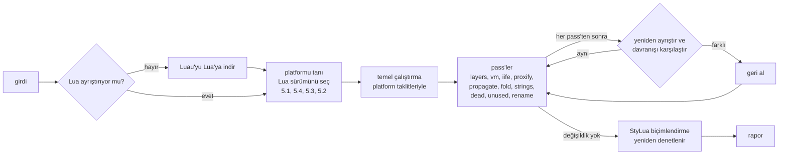

Ayrıştırma ve yeniden yazma JavaScript'te, [luaparse](https://github.com/fstirlitz/luaparse) ile AST üzerinde yapılır; kullanıcı
kodu yalnızca sandbox'ta ([`src/sandbox/`](src/sandbox)) çalışır. Her çalıştırma yeni bir `lua_State` açar ve yükleyicileri
kancalayan, yan etkileri kaydeden ve platform taklitlerini kuran prelude'u ([`src/sandbox/prelude.js`](src/sandbox/prelude.js))
yükler. Kod ve sonuçlar sınırı hex olarak geçer; ikili dizgeler ve NUL baytları asla bozulmaz.

| Klasör | İçerik |
|---|---|
| `src/passes/` | 10 pass |
| `src/core/` | hat, pass sırası, Lua yardımcıları, Luau indirme, kapsam analizi, rapor derleme |
| `src/sandbox/` | Lua ve Luau motorları, prelude, bekçi, Node ve tarayıcı barındırıcıları |
| `src/report/` | tespit, ticari koruma, tehdit analizi, IOC'ler, özet |
| `src/ui/` | web arayüzü |
| `src/cli/`, `bin/` | CLI |
| `test/` | fixture'lar, birim testleri ve benchmark |
| `scripts/` | benchmark ve fixture üreticileri |

## Güvenlik modeli

- **Kod yalnızca sandbox'ta çalışır.** Ayrıştırma, analiz ve yeniden yazma kullanıcı kodunu hiç çalıştırmaz; sandbox ayrı bir
  süreç (Node) ya da Web Worker'dır (tarayıcı).
- **Node (CLI, testler, kütüphane).** Sandbox süreci `node --permission` ile başlatılır ve yalnızca `node_modules`'u, sandbox
  dosyalarını ve `package.json`'u okuyabilir; alt süreç, worker ve dosya yazma işletim sistemi düzeyinde kapalıdır. Bu önemlidir,
  çünkü bu Lua çalışma zamanlarının Node derlemesi `os.execute`'u gerçek bir `child_process`'e bağlar: prelude onu kayıt tutan bir
  taklitle değiştirir, Lua kodu özgününe ulaşsa bile izin modeli onu engeller. Test paketi bunu gerçekten dener: `os.execute` ve
  `io.popen`, ayrıca `debug.getupvalue` ve `debug.getregistry` ile çağrılacak gerçek bir `execute` arama. Bir nöbetçi dosya asla
  oluşmamalıdır.
- **Tarayıcı.** Sandbox worker'ı kendi CSP'sini kendi yanıt başlığından alır:
  `default-src 'none'; script-src 'self' 'wasm-unsafe-eval'; connect-src 'self'`. Lua çalışma zamanları yüklendikten sonra worker
  ayrıca `fetch`, `XMLHttpRequest`, `WebSocket`, `EventSource`, `WebTransport`, `importScripts`, iç içe worker'lar, `caches`,
  `indexedDB`, `BroadcastChannel`, `eval`, `Function` kurucuları ve dizge zamanlayıcılarını kaldırır. Durum çubuğu hangi
  katmanların etkin olduğunu gösterir. Başlık veremeyen barındırmalarda (GitHub Pages) yalnızca JavaScript kilidi vardır ve durum
  çubuğu bunu uyarı olarak gösterir.
- **Bekçi.** Her isteğin bir son tarihi vardır (çalıştırma 10 sn, çalışma zamanı yükleme 60 sn). Kilitlenen worker ya da süreç
  öldürülür ve yenisi başlatılır. Lua içinde komut bütçesi sonsuz döngüleri daha önce durdurur. **Durdur** her şeyi anında
  sonlandırır.
- **Çalıştırmalar arası sızıntı yok.** Her çalıştırma yeni bir `lua_State` açar ve sonunda kapatır.
- **Fixture'lar diskte kodludur.** Zararlı koda benzeyen test örnekleri, antivirüs depoyu işaretlemesin diye XOR + base64 kodlu
  saklanır ve yalnızca bellekte çözülür.

## Dürüst sınırlar

- Prometheus **Medium** ve **Strong** preset'lerinin sanallaştırması kaldırılmaz. Çıktıları aynı davranır ve adlar temizlenir,
  ama VM ve kontrol akışı düzleştirmesi kalır, özgün dizge literallerinin hiçbiri geri gelmez (benchmark'a bakın).
- Sanallaştırması kaldırılmış **Vmify** çıktısı doğrudur ama güzel değildir: `goto` kullanır (Lua 5.2+) ve kayıt düzeyinde kalır
  (`__r[1] = "Hello"`); özgün kaynaktan çok VM'in talimatlarına yakındır.
- Tek başına **Cff** adımında dizgeler ve adlar geri gelir, ama düzleştirilmiş durum makinesi yapılandırılmış kontrol akışına
  geri çevrilmez.
- **IronBrew2** VM'leri hedeflenmedi. IronBrew tanınır ve `loadstring` katmanları diğerleri gibi açılır, ama onun için bir
  sanallaştırma kaldırıcı yoktur.
- **Luraph**, **Moonsec V3**, **Luarmor** ve **PSU** yalnızca tanınır, çözülmez.
- **Luau çalışma zamanı yalnızca Node'da çalışır.** Tarayıcıda Luau yine Lua'ya indirilir, ama indirme özgün Luau koduyla
  karşılaştırılarak doğrulanamaz; log bunu yazar. Bazı Luau yapıları (tip fonksiyonları, `//`, `repeat` gövdesinde local varken
  `continue`) indirmeyi durdurur.
- Öznitelik kullanan Lua 5.4 kodu (`<const>`, `<close>`) ayrıştırılmaz: ayrıştırıcı Lua 5.3'e kadarki sözdizimini anlar.
- Lua bytecode'u (`\27Lua`) raporda listelenir, kaynağa çevrilmez.
- Davranış denetimi stdout'u, hataları ve denenen yan etkileri karşılaştırır. Gerçek ortamı olmadan çalışamayan kod yalnızca
  statik dönüşümlerden geçer ve sonuç doğrulanmamış olarak işaretlenir.
- Çalışma anında yakalanan değerler o çalıştırmanın geçtiği yolları kapsar. Çalışmayan dallar denetlenmez.
- Dış girdiye bağlı katmanlar (HTTP yanıtı, dosya, ortam) korunur, açılmaz.

## Testler

```bash
npm test                       # 25 fixture tüm hattan davranış denetimiyle geçer, ardından 7 birim test dosyası
node test/run.js char-decoder  # tek bir fixture, log ve çıktısıyla
```

Fixture, [`test/fixtures/`](test/fixtures) içinde yönerge yorumları olan bir `.lua.x` dosyasıdır (diskte kodlu, yukarıya bakın):

```lua
-- EXPECT: print('hi')   çıktıda bulunmalı
-- GONE: loadstring      çıktıda bulunmamalı
-- KEEP: HttpGet         çıktıda kalmalı (yan etkiler ve girdiye bağlı kod silinmemeli)
-- LUAU: verified        Luau indirmesi luau-web çalışma zamanında doğrulanmalı
```

Fixture'lar `load` zincirlerini (iç içe, takma adlı, Lua 5.4 `load`), `string.char` ve ondalık kaçış çözücülerini, sabit
dizileri, dizge çözücülerini, IIFE'leri, ölü dalları, ProxifyLocals'ı, bir Prometheus VM'ini, yeniden adlandırmayı, shebang
satırlarını, Luau sözdizimini ve korunması gereken kodu kapsar: Roblox uzaktan yükleyicileri, FiveM ve Garry's Mod arka kapıları,
yan etkiler ve girdiye bağlı katmanlar. Birim testleri raporu ve tespit modüllerini (`analyze`), CLI'yı, çevirileri, Lua
yardımcılarını, Luau indirmesini, tarayıcı sandbox'ının yükleme yolunu ve CSP'sini, sandbox kaçış denemelerini kapsar.

## Benchmark

```bash
npm run bench              # tüm örnekler
npm run bench vmify        # adı filtreyi içeren örnekler
npm run bench -- --show x  # tek örneğin girdisi, logu ve çıktısı
```

[`test/bench/`](test/bench), [Prometheus](https://github.com/levno-710/Prometheus)'un (commit `a98c501`) preset'leri ve tek
adımlarıyla dört zararsız kaynak program üzerinde çalıştırılmasıyla üretilmiş 28 örnek içerir
([`scripts/make-bench.js`](scripts/make-bench.js)). Bir örnek, çözülmüş kod özgün programla tam olarak aynı çıktıyı verdiğinde
geçer. Gizlenmiş programın kendisi özgünden farklı yazıyorsa (aracın hatası) ölçü gizlenmiş programın çıktısıdır. "Tüm
literaller geri geldi", özgün koddaki beklenen her dizgenin çıktıda bulunması demektir.

Son çalıştırma (`npm run bench`):

| Preset ya da adım | Örnek | Aynı davranış | Tüm literaller geri geldi |
|---|---|---|---|
| Minify | 1 | 1 | 1 |
| Weak | 4 | 4 | 4 |
| Medium | 4 | 4 | 0 |
| Strong | 3 | 3 | 0 |
| Vmify | 4 | 4 | 4 |
| EncryptStrings | 3 | 3 | 3 |
| ConstantArray | 2 | 2 | 2 |
| ProxifyLocals | 2 | 2 | 2 |
| NumbersToExpressions | 2 | 2 | 2 |
| SplitStrings | 1 | 1 | 1 |
| WrapInFunction | 1 | 1 | 1 |
| Cff | 1 | 1 | 1 |
| **Toplam** | **28** | **28** | **21** |

Yedi Medium ve Strong örneğinde bir VM dağıtıcısı kalır ve özgün literallerin hiçbiri geri gelmez; davranışları yine aynıdır.
Bir ProxifyLocals örneği (`textutil`) gizlenmiş programın kendi çıktısına göre ölçülür, çünkü Prometheus yazdırdığını değiştirir.
Tek adımlar ve Weak preset'i örnek başına en çok 2,2 saniye, Medium yaklaşık 3 ila 7 saniye, Strong yaklaşık 9 ila 12 saniye
sürer.

## Katkı

Issue ve pull request'ler memnuniyetle karşılanır. PEEL'in çözemediği bir örneğiniz varsa küçük ve zararsız bir sürümüyle issue
açın. Düzeltmeyi kanıtlayan bir fixture ekleyen pull request en hızlı birleşen pull request'tir.

## Lisans

[MIT](LICENSE). Ticari kullanım dahil özgürce kullanabilir, değiştirebilir ve dağıtabilirsiniz. Ücretli sürüm, hesap ya da telemetri yoktur.
